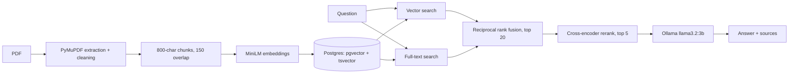

# Thesis Q&A: a measured RAG pipeline

Ask questions about a PDF and get answers with page references. Built over a 102-page civil engineering thesis (foam concrete durability), runs fully locally, and comes with an evaluation set so each design choice is backed by numbers.

**Stack:** Python, PostgreSQL + pgvector, Postgres full-text search, sentence-transformers, Ollama (`llama3.2:3b`), PyMuPDF, Docker Compose

## Pipeline



1. **Ingestion** (`ingest.py`): extract text per page, strip table-of-contents dot leaders, skip front matter, chunk with overlap, drop tiny chunks, embed and store with the page number.
2. **Retrieval** (`retrieval.py`): vector search and keyword search are fused with reciprocal rank fusion, then a cross-encoder rescores the top 20.
3. **Answering** (`answer.py`): the top 5 chunks go to a local LLM, which must answer only from them or say "I could not find this in the document." The command-line tool also prints a "Retrieved from" line with the source pages.

## Results

Measured on 23 answerable questions about the thesis. "Answer hit@5" means a top-5 chunk contains the text of the answer.

| Retrieval method | Answer hit@1 | Answer hit@5 |
|---|---|---|
| Vector only | 10/23 (43%) | 12/23 (52%) |
| Full-text only | 14/23 (61%) | 16/23 (70%) |
| Hybrid (vector + full-text) | 11/23 (48%) | 17/23 (74%) |
| Hybrid + cross-encoder rerank | 17/23 (74%) | 21/23 (91%) |

End-to-end with `llama3.2:3b` on a laptop CPU: 4/4 unanswerable questions correctly refused, about 15 to 21 seconds per answer. Manual grading of all 23 answers gave 20 correct, 2 partial and 1 wrong; the wrong answer was a table lookup where the model read values from the wrong rows, so table answers should not be trusted.

Full tables, failure analysis, a change log and limitations are in [RESULTS.md](RESULTS.md). The development numbers are optimistic because the pipeline was tuned while looking at the same questions; a held-out set (`eval_holdout.json`) is reserved for a final check.

## Run it

Requires Docker Desktop, Python 3.10+ and [Ollama](https://ollama.com).

```bash
docker compose up -d
python -m venv .venv
.venv\Scripts\Activate.ps1          # Windows PowerShell
pip install -r requirements.txt
ollama pull llama3.2:3b
```

Add your own PDF (it is not included in this repository), then:

```bash
python ingest.py yourfile.pdf 15    # second argument: number of front-matter pages to skip
python answer.py "your question"
```

Evaluate retrieval and answers (these use the thesis-specific files `eval.json` and `eval_holdout.json`, so write your own for another document):

```bash
python retrieval.py
python answer_eval.py
```

## Files

| File | Purpose |
|---|---|
| `ingest.py` | PDF to chunks, embeddings and Postgres rows |
| `retrieval.py` | vector, full-text, hybrid and reranked search, plus the retrieval evaluation |
| `answer.py` | answer generation with a local LLM |
| `answer_eval.py` | end-to-end check: refusals, citations, latency, saved answers |
| `grade_summary.py` | counts manual grades from `answers.json` |
| `eval.json`, `eval_holdout.json` | evaluation questions with answer strings |
| `sql/init.sql` | schema: pgvector HNSW index and full-text GIN index |

## Limitations

- Small evaluation set (23 development, 8 held-out questions) on one document and one small local model.
- Tables are extracted as flat text and the model can misread them. Row-aware table extraction has not been tried.
- A 3B model does not reliably follow the citation format, so the interface shows retrieval-based source pages instead. Those are pages the answer was retrieved from, not proof the model verified each claim.
- Scanned PDFs (no text layer) are not supported.
- No web API, caching or interface yet; it runs from the command line.

## Possible next steps

- Row-aware table extraction.
- Chunking across page boundaries.
- A FastAPI endpoint with Redis caching and rate limiting.
- Test a larger local model and compare.